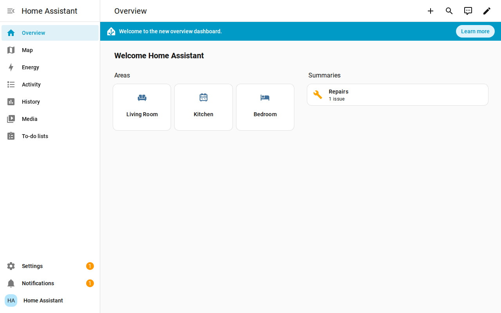

# Home Assistant

Home Assistant is the open-source home automation platform that puts local control and privacy first — automations, dashboards, and hundreds of integrations for lights, sensors, media, and more, all running on your own server with no cloud account required. One click deploys the official image (homeassistant/home-assistant 2026.11.2, Apache-2.0): the owner account is seeded on first boot, the port is mapped automatically, and your entire configuration survives redeploys on a Railway volume.

Screenshot: the live dashboard of this template's own Railway deployment after onboarding, showing the default areas and the test automation created during end-to-end verification.

## Source Repository

[https://github.com/INAPP-Mobile/home-assistant](https://github.com/INAPP-Mobile/home-assistant)

## Deploy and Host

One click deploys Home Assistant 2026.11.2 (official `homeassistant/home-assistant` image, pinned by digest) as a single service. The deploy form has one generated field — the owner account password — and nothing else to fill in. On first boot the owner account (`admin` + your generated password) is created automatically through the onboarding API, and the site is ready: log in, finish the two quick onboarding screens (location, units), and start building automations. No email step, no cloud account, no hardware dongle needed for the core platform.

## Why Deploy

- **Zero-fuss start:** no setup wizard to click through for the account — the owner is seeded on first boot and you log straight in with the generated password.
- **Local-first automation:** automations, scripts, scenes, and dashboards run on your own instance; your device states and history stay in your own SQLite database on your own volume.
- **Hundreds of integrations:** lights, switches, sensors, media players, weather, calendars, and more — add them from Settings → Devices & Services.
- **Built for Railway:** the wrapper maps Railway's injected `PORT` onto Home Assistant's `server_port` on every boot, trusts the Railway proxy for real client IPs (so failed-login protection can't ban the proxy), and persists all of `/config` across redeploys.

## Common Use Cases

- Run a smart-home hub without dedicated hardware — automations and dashboards from anywhere, with no cloud subscription.
- Automate lights, climate, and notifications with Home Assistant's visual automation editor.
- Track devices and sensors in one dashboard, with history and energy monitoring built in.
- Prototype integrations and automations on a disposable cloud instance before committing them to a home server.

## Configuration

| Variable | Default | What it does |
|---|---|---|
| `HA_ADMIN_PASSWORD` | `${{secret(16)}}` (generated) | Password for the auto-seeded owner account (username `admin`). Log in with it after deploy; change it later from your profile. |
| `HA_ADMIN_USERNAME` | `admin` | Username of the seeded owner account. |
| `PORT` | injected by Railway (8080) | Mapped onto `http: server_port:` in `/config/configuration.yaml` by the wrapper entrypoint on every boot. Home Assistant does not read a `PORT` env var — the config file is the only mechanism. |
| `TZ` | `UTC` (baked) | Container timezone. The in-app time zone (Settings → System → General) takes precedence for display. |
| `RAILWAY_PUBLIC_DOMAIN` | set by Railway | Used only by the owner seeder as the onboarding `client_id`; never baked into the config file. |

Home Assistant itself is configured through `/config/configuration.yaml` and the UI (Settings → System → General for location, units, and time zone; Settings → Devices & Services for integrations) — it does not take feature configuration from environment variables. The wrapper manages only `http: server_port:` in `configuration.yaml` (created on first boot from upstream's own `DEFAULT_CONFIG` — `default_config`, frontend themes, and the `automation:`/`script:`/`scene:` includes — plus a `homeassistant: name` and proxy-trusted settings); everything else in that file is yours and survives redeploys untouched. See the [upstream documentation](https://www.home-assistant.io/docs/configuration/) for the full configuration reference.

### Deployment Dependencies

- **Runtime:** Home Assistant 2026.11.2 (Python 3.13, s6-overlay); single service, SQLite recorder by default. Fits the Hobby plan (roughly 400–600 MB RAM at rest).
- **Port:** 8080 by default, mapped from Railway's injected `PORT` onto `http: server_port:` on every boot.
- **Persistence:** one Railway volume at `/config` (configuration, `.storage`, SQLite history database). Survives redeploys.
- **Healthcheck:** `/` (frontend app shell, unauthenticated, 200).
- **Plan tier:** Hobby plan; one service.
- **Limits:** no USB/Zigbee/Z-Wave hardware on Railway — local radio sticks can't attach, so use network/Wi-Fi integrations (or MQTT over the network). Add-ons (the Supervisor ecosystem) are not part of the Core container; core integrations and automations all work.
