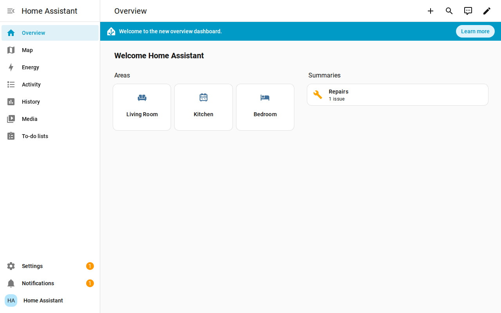

Screenshot: the live dashboard of this template's own Railway deployment after onboarding, showing the default areas and the test automation created during end-to-end verification.

# Deploy and Host

Home Assistant is the open-source home automation platform that puts local control and privacy first — automations, dashboards, and hundreds of integrations for lights, sensors, media, and more, all running on your own server with no cloud account required. One click deploys the official image (homeassistant/home-assistant 2026.11.2, Apache-2.0) as a single service: the owner account is seeded on first boot, the port is mapped automatically, and your entire configuration survives redeploys on a Railway volume. The deploy form has one generated field — the owner account password — and nothing else to fill in. On first boot the owner account (`admin` + your generated password) is created automatically through the onboarding API, and the site is ready: log in, finish the two quick onboarding screens (location, units), and start building automations.

## About Hosting

Home Assistant runs as one Python 3.13 service from the official image, pinned by digest (manifest list sha256:493a07e8…), under s6. Everything lives on a single Railway volume at `/config` (configuration, `.storage`, SQLite history database) and survives redeploys. Railway's injected `PORT` is passed to Home Assistant as the upstream `SETUP_PORT` env var by the wrapper entrypoint on every boot — the supported way to set the listen port (HA 2026.11 trials a YAML `http: server_port:` for 5 minutes, then reverts to 8123, so the port is deliberately kept out of the config file) — and the wrapper writes the reverse-proxy trust settings (`use_x_forwarded_for` + `trusted_proxies`) into HA's `.storage/http` store, since without them HA answers HTTP 400 to every request from the Railway edge. The healthcheck is `/auth/authorize` (authorize page, unauthenticated, 200). The marketplace incumbents ship the moving `:latest` tag with no port handling and no seeded account; this template fixes the usual failure modes (pinned digest, PORT remap, volume persistence, generated owner password).

## Why Deploy

- **Zero-fuss start:** no setup wizard to click through for the account — the owner is seeded on first boot and you log straight in with the generated password.
- **Local-first automation:** automations, scripts, scenes, and dashboards run on your own instance; your device states and history stay in your own SQLite database on your own volume.
- **Hundreds of integrations:** lights, switches, sensors, media players, weather, calendars, and more — add them from Settings → Devices & Services.
- **Built for Railway:** the wrapper sets Home Assistant's listen port from Railway's injected `PORT` via the upstream `SETUP_PORT` env var, writes the reverse-proxy trust settings into HA's HTTP store so the Railway edge is accepted, and persists all of `/config` across redeploys.

## Common Use Cases

- Run a smart-home hub without dedicated hardware — automations and dashboards from anywhere, with no cloud subscription.
- Automate lights, climate, and notifications with Home Assistant's visual automation editor.
- Track devices and sensors in one dashboard, with history and energy monitoring built in.
- Prototype integrations and automations on a disposable cloud instance before committing them to a home server.

## Dependencies for

### Deployment Dependencies

- **Runtime:** Home Assistant 2026.11.2 (Python 3.13, s6-overlay); single service, SQLite recorder by default. Fits the Hobby plan (roughly 400–600 MB RAM at rest).
- **Port:** 8080 by default, set from Railway's injected `PORT` via the upstream `SETUP_PORT` env var on every boot.
- **Persistence:** one Railway volume at `/config` (configuration, `.storage`, SQLite history database).
- **Healthcheck:** `/auth/authorize` (authorize page, unauthenticated, 200).
- **Plan tier:** Hobby plan; one service.
- **Limits:** no USB/Zigbee/Z-Wave hardware on Railway — local radio sticks can't attach, so use network/Wi-Fi integrations (or MQTT over the network). Add-ons (the Supervisor ecosystem) are not part of the Core container; core integrations and automations all work.

**Environment variables (condensed reference):** `HA_ADMIN_PASSWORD` (`${{secret(16)}}` — password for the auto-seeded owner account, username `admin`; log in with it after deploy, change it later from your profile), `HA_ADMIN_USERNAME` (`admin` — username of the seeded owner account), `PORT` (injected by Railway, passed to Home Assistant as `SETUP_PORT` by the wrapper entrypoint on every boot), `TZ` (`UTC`, baked — container timezone; the in-app time zone takes precedence for display), `RAILWAY_PUBLIC_DOMAIN` (set by Railway — used only by the owner seeder as the onboarding `client_id`; never baked into the config file). Home Assistant itself is configured through `/config/configuration.yaml` and the UI, not environment variables; the wrapper only ensures the `automation:`/`script:`/`scene:` includes from upstream's own `DEFAULT_CONFIG` are present in that file (created on first boot from that `DEFAULT_CONFIG`, plus a `homeassistant: name`) and keeps HA's `.storage/http` store serving Railway's `PORT` behind the edge proxy (`use_x_forwarded_for` + `trusted_proxies`). See the [upstream documentation](https://www.home-assistant.io/docs/configuration/) for the full configuration reference.
